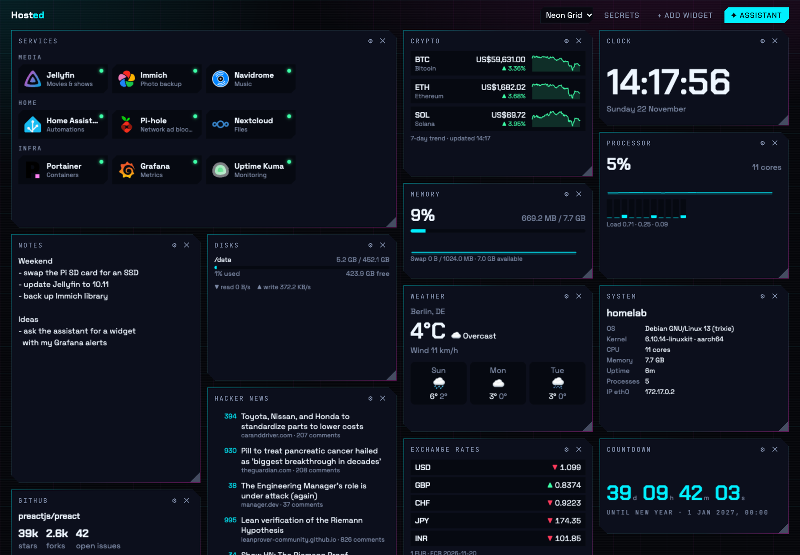
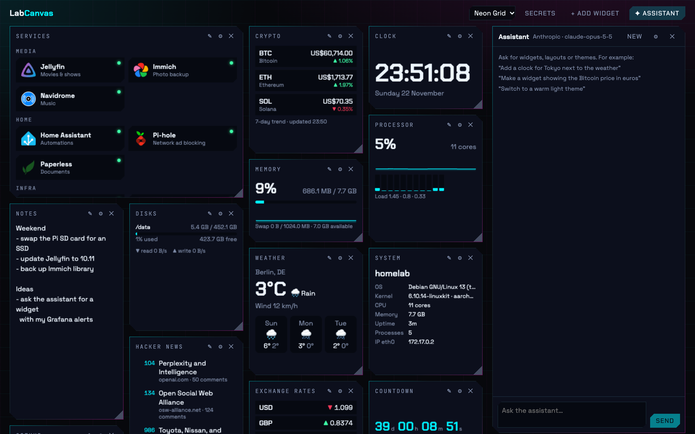
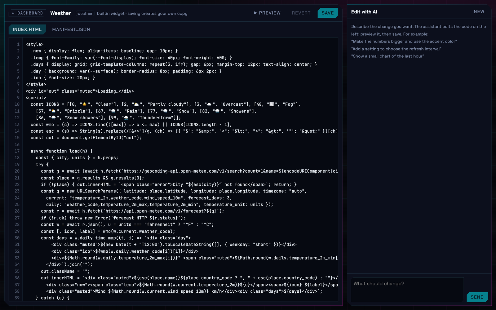
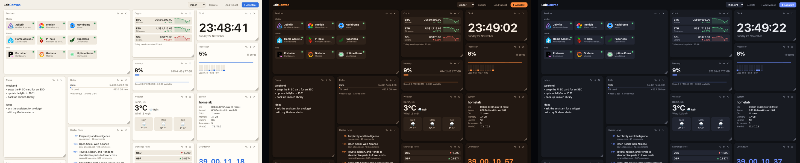
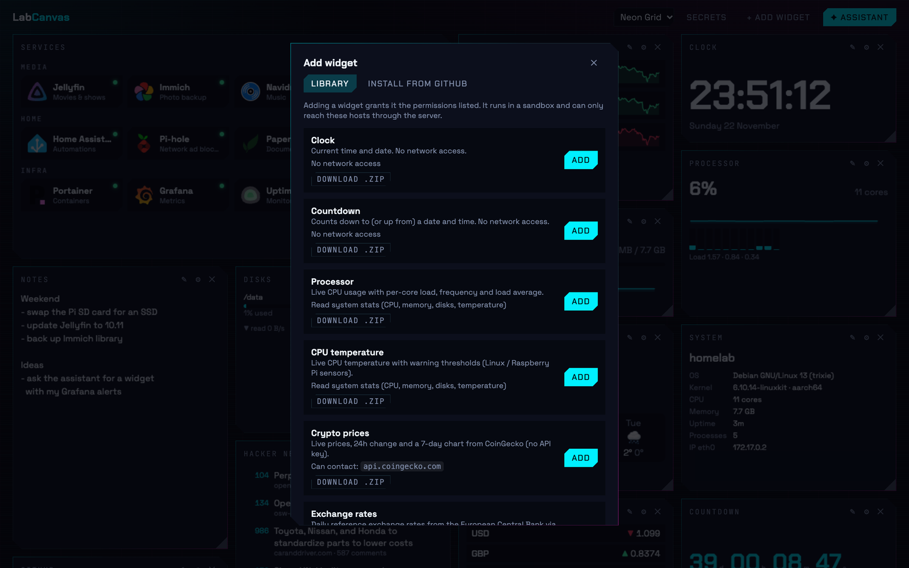

<div align="center">

# LabCanvas

**A self-hosted dashboard you build by chatting with AI.**

Ask for a widget, a layout or a whole new look, and it appears on your dashboard,
running safely in a sandbox. Made for the homelab: light enough for a Raspberry Pi, no build step.

[](https://github.com/shahnshahmalik/labcanvas/actions/workflows/ci.yml)
[](LICENSE)
[](https://github.com/shahnshahmalik/labcanvas/pkgs/container/labcanvas)



</div>

## Highlights

- **AI that builds your dashboard.** Bring your own Anthropic, OpenAI or Ollama key. The assistant
  writes new widgets, arranges the grid and designs themes, and it can't grant itself any access.
- **Edit any widget by chatting.** Open a widget's code next to an AI chat, preview the draft, save.
- **14 built-in widgets**, from live CPU, memory, disk and temperature stats to crypto charts and a
  homepage-style services launcher with up/down status.
- **Sandboxed by design.** Every widget runs in an isolated iframe with no network access of its
  own. It can only reach the hosts, secrets and server features *you* approve, through a proxy.
- **Themes are just files.** Four built in (Neon Grid, Midnight, Paper, Ember), each a small JSON
  file of design tokens you can copy and edit, or let the AI design one for you.
- **A widget ecosystem.** Install widgets from any GitHub repo, or download a widget you made as a
  `.zip` and publish it for others.
- **Pi-friendly.** FastAPI + SQLite + Preact, no frontend build, multi-arch Docker image
  (amd64 and arm64).

## Quick start

```bash
docker run -d --name labcanvas -p 8080:8080 -v labcanvas-data:/data ghcr.io/shahnshahmalik/labcanvas:latest
```

Then open **http://localhost:8080**. A fresh install starts with the Neon Grid theme and a starter
layout. To try the assistant, click **✦ Assistant**, open its settings and add your API key.

LabCanvas works on phones too and can be installed as an app (*Install* in Chrome or Edge, *Add to
Home Screen* on iOS). Browsers only offer installing over **https://** or on localhost, so put it
behind your reverse proxy with a certificate.

<details>
<summary><b>Docker Compose</b></summary>

```bash
curl -O https://raw.githubusercontent.com/shahnshahmalik/labcanvas/main/compose.yaml
docker compose up -d
```

See [`compose.yaml`](compose.yaml) for the optional host-disk mounts.
</details>

<details>
<summary><b>Build from source / run without Docker</b></summary>

```bash
git clone https://github.com/shahnshahmalik/labcanvas && cd labcanvas
docker build -t labcanvas . && docker run -d -p 8080:8080 -v labcanvas-data:/data labcanvas
```

Or with plain Python 3.12+:

```bash
python3 -m venv .venv && .venv/bin/pip install -r requirements.txt
.venv/bin/uvicorn app.main:app --host 0.0.0.0 --port 8080
```
</details>

## The assistant



Tell it what you want in plain words:

- *"Add a widget with the Bitcoin price in euros and a 30-day chart"*
- *"Put my system stats in one row at the top and make the clock smaller"*
- *"Design a warm light theme with rounded corners"*
- *"The weather widget shows an error, fix it"*

It works with **Anthropic** (Claude, the default is `claude-opus-5-5`), **OpenAI** or any
OpenAI-compatible API, and **Ollama** for fully local models. Your key stays on your server and
is only ever sent to the provider you picked.

The assistant can create widget types, add, move and remove widgets, and set or save themes. What
it **can't** do is grant permissions: a widget it adds that wants network access shows an
**Allow** bar, and nothing happens until you click it.

## Edit any widget with AI



Every widget has a **✎** button. It opens the widget's code with an AI chat beside it: describe
the change (*"make the numbers bigger"*, *"add a setting for the refresh interval"*), the
assistant edits the code, you press **Preview** to try your draft in the real sandbox, then
**Save**. Built-in and installed widgets are never modified: saving creates your own copy.

## Built-in widgets

| | Widget | What it shows |
|---|---|---|
| 🧭 | **Services** | Your self-hosted apps as icon tiles (dashboard-icons) with live up/down status |
| 🖥️ | **Processor** | Live CPU usage, per-core load, frequency, load average |
| 🧠 | **Memory** | Live RAM and swap usage with history |
| 💽 | **Disks** | Drive usage plus live read/write throughput |
| 🌡️ | **CPU temperature** | Live temperature with warning thresholds (Pi and Linux sensors) |
| ℹ️ | **System info** | Hostname, OS, model, kernel, uptime, IP addresses |
| 📈 | **Crypto prices** | Prices, 24h change and 7-day sparklines (CoinGecko) |
| 💱 | **Exchange rates** | Daily ECB rates with change arrows (Frankfurter) |
| ⛅ | **Weather** | Current conditions and 3-day forecast (Open-Meteo) |
| 🕐 | **Clock** | Time and date, any time zone |
| ⏳ | **Countdown** | Days, hours, minutes to any date |
| 📝 | **Notes** | A sticky note that saves as you type |
| 📰 | **Hacker News** | Top, best, new, Ask or Show stories, click to open |
| 🐙 | **GitHub repo** | Stars, forks, issues and latest release |

None of them need an API key. Every widget has its own settings (⚙ on the card).

## Themes



Switch themes from the menu in the header, or ask the assistant. Each theme is a JSON file of
design tokens in [`themes/`](themes/): colors, fonts, corner radius, card shapes, backdrop. To make
your own, copy one, change the values and restart. [`themes/README.md`](themes/README.md) lists
every token. The dashboard and all widgets style themselves only through these tokens, so a theme
file fully controls the look.

## Widgets: make, share, install



A widget is a folder with two files, `manifest.json` (name, size, settings, permissions) and
`index.html`, using a small `hosted` SDK:

```html
<div id="out">Loading…</div>
<script>
  hosted.ready.then(async (h) => {
    const r = await h.fetch("https://api.coingecko.com/api/v3/simple/price?ids=bitcoin&vs_currencies=eur");
    const { bitcoin } = await r.json();
    document.getElementById("out").textContent = `₿ ${bitcoin.eur.toLocaleString()} €`;
  });
</script>
```

- **Share:** *Add widget → Library → Download .zip* gives you a ready-to-publish package. Push it
  to GitHub.
- **Install:** *Add widget → Install from GitHub* takes a repo or folder URL, shows what the widget
  will be allowed to do, and installs exactly the commit you previewed. Update checks are built in.

The full manifest format, SDK reference and publishing guide are in [WIDGETS.md](WIDGETS.md).

## How the sandbox works

- Widgets run in `sandbox="allow-scripts"` iframes with an opaque origin and a strict
  Content-Security-Policy: no direct network, cookies, storage or access to the dashboard.
- All traffic goes through the server's proxy, which only allows the **hosts** the widget
  declared *and* you approved. **Secrets** (API keys) are written into requests by the server, so a
  widget never sees them. **Capabilities** such as reading system stats are approved the same way.
- A widget update can't quietly gain access: new permissions need your approval again.

Details and known limits are in [WIDGETS.md](WIDGETS.md#security-model) and
[SECURITY.md](SECURITY.md).

> [!IMPORTANT]
> LabCanvas has **no login yet**. Run it on your home network or behind a reverse proxy with
> authentication (Authelia, Authentik, Cloudflare Access, Tailscale, …).

## Configuration

| Variable | Default | Purpose |
|---|---|---|
| `LABCANVAS_DB` | `/data/canvas.db` in Docker | SQLite database location |
| `LABCANVAS_DISK_PATHS` | auto | Comma-separated mount points for the Disks widget, e.g. `/hostfs,/hostfs-usb` |

Everything else (AI provider, secrets, theme, layout) is set in the UI. What a brand-new install
starts with lives in [`defaults/dashboard.json`](defaults/dashboard.json).

<details>
<summary><b>Show host drives and hostname in Docker</b></summary>

CPU, memory and temperature already come from the host. For drives and the hostname:

```bash
docker run -d --name labcanvas -p 8080:8080 -v labcanvas-data:/data \
  --hostname "$(hostname)" \
  -v /:/hostfs:ro -v /mnt/usb:/hostfs-usb:ro \
  -e LABCANVAS_DISK_PATHS=/hostfs,/hostfs-usb \
  ghcr.io/shahnshahmalik/labcanvas:latest
```
</details>

## Roadmap

- [ ] Login and multi-user access
- [ ] Docker auto-discovery to fill the Services widget
- [ ] Dashboard export and import
- [ ] Streaming replies for OpenAI and Ollama
- [ ] A community widget gallery

Ideas and widget requests are welcome in [issues](https://github.com/shahnshahmalik/labcanvas/issues).

## Contributing

See [CONTRIBUTING.md](CONTRIBUTING.md). There's no build step, so `uvicorn --reload` and a browser
refresh are all you need.

## License

[MIT](LICENSE). Bundled third-party components (Preact, htm, the Space Grotesk, Chakra Petch and
JetBrains Mono fonts) keep their own licenses; see [THIRD_PARTY_NOTICES.md](THIRD_PARTY_NOTICES.md).
Service icons come from [dashboard-icons](https://github.com/homarr-labs/dashboard-icons).
